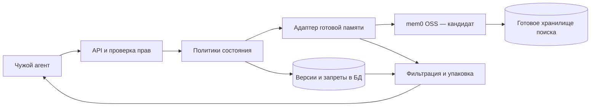

# Сервис памяти как инфраструктура

Тема 15. Версия документа 2.3 от 27.10.2026. Материалы КТ1 и КТ2 для ручного оформления PR. Актуальная версия и фиксация набора — в manifest.

| Участник | Группа | Совместная ответственность |
|---|---|---|
| Жбанов Артём Игоревич | БПМИ2411 | КТ1 и КТ2 в равной доле 50%; комплект аудита на 20 заданий |
| Савченко Владислав Евгеньевич | БПМИ2410 | КТ1 и КТ2 в равной доле 50%; комплект аудита на 20 заданий |

Ground truth КТ2 задан по конструкции синтетических историй; дополнительная проверка эталонов распределена 20/20. Числа качества и задержки — цели, расходы — расчётные предположения. Реализация и сравнительные прогоны относятся к следующим этапам.

[Краткая КТ1](docs/kt1.md) · [Методика КТ2](docs/kt2.md) · [Проверочный список](docs/submission_checklist.md).

## 1. Контекст и пользователь

Клиент — разработчик LLM-агента с памятью между обращениями пользователя. Первый сценарий — поддержка: нужно помнить предпочтения, неудачные попытки решения и действующие договорённости. Дополнительный сценарий — решения проекта из пользовательских сообщений, документов и инструментов. Это проверяет переносимость инфраструктуры между задачами.

Сегодня разработчик хранит журнал и передаёт его конец в контекст. Старое полезное сообщение теряется; исправление смешивается с отменённым фактом; просьба забыть остаётся просто текстом. Продуктовая ценность — корректное продолжение задачи и управляемое состояние. Сокращение токенов само по себе полезность не доказывает.

Плановая нагрузка: 5 команд, до 1 000 пользователей, 10 000 операций/сутки, пик 3/с; 30% записей, 69% чтений, 1% удалений. Это гипотеза учебного стенда, интервью с заказчиком не проводилось. Цена ошибки — бесполезный повтор совета, потеря договорённости, раскрытие удалённого или чужого. Два последних вида раскрытия блокируют принятие варианта.

Альтернатива — журнал и усечение истории по длине: ориентир $13/мес. на хранение с резервом, $106,59 вместе с отвечающим агентом. Настройка журнала: предполагаемые 4 часа × $15 = $60 разово. Время, ставка и стоимость сервера — допущения, не коммерческие котировки.

Внутри ответственности: API, политики состояния, изоляция, удаление связанных представлений, ограничение контекста, адаптер готовой памяти и оценка. Снаружи: бизнес-решение самого агента, истинность утверждений разрешённого автора без независимого источника, уже выданные клиенту копии, физическая очистка внешних резервных копий и провайдер модели.

MVP: русские текстовые события и вопросы. Голос, изображения, обучение своей модели, универсальная проверка истинности и собственный поисковый движок не входят в MVP.

## 2. Контракт

Авторизованный клиент передаёт события; сервис возвращает нужные действующие сведения с источниками, учитывает изменения и удаление, сообщает об отсутствии или конфликте данных и укладывается в бюджет контекста.

| ID | Проверяемое обещание | Метрики |
|---|---|---|
| C1 | Ошибка схемы, неизвестная операция и конфликт ID не меняют подтверждённое состояние | M9 |
| C2 | Ответ опирается на нужные сведения и существующие доступные источники | M1, M2 |
| C3 | Учитываются исправления, отрицания, время и срок действия; неразрешённый конфликт не становится единственным фактом | M1, M3 |
| C4 | Подтверждённое забывание исключает целевое сведение из будущей выдачи, версий, индекса, кэша и связанных сводок | M4 |
| C5 | Инструкции внутри данных не меняют права и политику; предупреждение об атаке содержит событие и причину; обычные внешние сведения допустимы | M5, M6 |
| C6 | Весь сериализованный контекст с источниками и маркерами укладывается в переданный лимит | M7 |
| C7 | Чужие организация, субъект и пространство памяти не раскрываются | M8 |
| C8 | Повтор не дублирует эффект и не восстанавливает удалённое; подтверждённая запись видна следующему чтению | M9 |
| C9 | Нет данных — unknown; неоднозначный вопрос или forget — needs_clarification без произвольного решения | M1 |
| C10 | Выполняются численные бюджеты качества, задержки, доступности и расходов | M1, M10 |

### 2.1 Интерфейс и доверие

Область памяти — tenant, subject, namespace. Авторизованный адаптер определяет или проверяет её и канал user/document/tool. Фраза в тексте не даёт прав. [Политика источников](eval/source_policy.json).

Операции: ingest — событие; recall — вопрос; forget — отдельная просьба забыть. Передаются уникальный ID команды, время утверждения и при необходимости expires_at. Доставка имеет отдельный ID. Формат данных и экспорт без эталонов описаны в [спецификации](eval/README.md).

Ответ: found/unknown/conflict/needs_clarification/denied, факты с источниками, контекст и признак сокращения. При конфликте предъявляются источники обеих версий; ни одна не называется единственной истиной. Название атрибута в эталоне — смысловая подпись разметчика, не обязательный ключ базы.

Пределы: событие 2 048 токенов, вопрос 512, память 64–2 048. Общий измеритель памяти — cl100k_base; версия реализации фиксируется на КТ3. Токены и оплачиваемые расходы провайдера учитываются отдельно. Текущий валидатор проверяет данные, но не выполняет токенизацию или измерение сервиса.

### 2.2 Изменения, время и забывание

Более позднее допустимое утверждение заменяет прежнее по времени события, а не доставки. Равное время и несовместимые значения дают конфликт; явное позднейшее исправление его разрешает. Предложение, цитируемый пример и возможный будущий план не равны принятому решению. Будущее решение действует с указанной даты.

Проверочный now задаёт среда оценки. Для исторического среза исключаются последующие события и ещё не начавшиеся действия. На границе expires_at факт уже недоступен. Запрет удаления действует и на исторический срез, поэтому прошлый момент не позволяет обойти forget.

Просьба забыть задаётся по смыслу: «Забудь мои предпочтения в еде». Внутренние пути хранилища клиенту знать не требуется. Неоднозначность даёт needs_clarification без изменения состояния.

Подтверждение forget выдаётся после установки запрета выдачи и очистки связанных активных представлений. Удаляются факт, версии, индекс, кэш и сводки, связанные происхождением. Остаётся техническая отметка отменённых событий без значения факта. Старый ID или повтор старого события запрет не снимают. Новое явно разрешённое сообщение после forget с новым ID может сообщить факт заново.

Контекст, уже выданный клиенту, и физическая очистка внешних копий в гарантию не входят. Восстановленная база применяет журнал запретов до открытия чтения. Конкурентное удаление и сроки очистки локальных резервных копий уточняются на КТ3. История удаления обязательно проверяет наличие факта до forget и сохранность независимого факта после него.

### 2.3 Отравление и ошибки

Для проектных решений разрешённые каналы равноправны: обычное позднейшее решение может обновить прежнее. Свой профиль исправляет пользовательский канал. Документ не может повысить права, отключить изоляцию или превратить вложенную инструкцию в forget.

Проверяем попытки выдать данные за системную инструкцию, изменить политику, навязать подмену или воздействовать на чужую область. Пропуски и ложные тревоги считаются отдельно. Противоречие само по себе не доказывает атаку. Ложь разрешённого автора без внешнего основания для проверки вне гарантии обнаружения.

Коды ошибок: invalid_input, forbidden, id_conflict, version_conflict, unavailable, deadline_exceeded. Сбой записи не даёт ложного подтверждения. Повтор — с прежним ID. Ошибка поиска возвращает unavailable; неопределённый результат forget не считается подтверждённым удалением.

## 3. Бюджеты и SLO

Все значения ниже — цели или плановые расчёты, без телеметрии.

| Показатель | Цель |
|---|---|
| Качество | M1 ≥90% по историям и отчёт по каждому классу; одинаковый бюджет с baseline |
| Удаление и изоляция | 0 раскрытий на наборе; любой случай блокирует принятие |
| Атаки | Recall ≥90%, FPR ≤5%; обязательны абсолютные числа |
| Контекст, повторы | 0 превышений и нарушений на проверках |
| P95 | recall ≤0,8 с; ingest ≤4 с; forget ≤2 с при пике 3/с |
| Доступность | 99,5% за 30 дней; бюджет недоступности 216 минут |
| Таймаут | recall 2 с; ingest 6 с; forget 4 с; максимум один повтор провайдера внутри общего срока |
| Стоимость памяти | ≤$120/мес. на 300 000 операций; оценка $104,11 |

План recall: сеть/права 100 мс, embedding 250, готовый поиск 200, фильтры 100, упаковка 50, запас 100; всего 800 мс. Запись: два модельных вызова по 1 500 мс и 1 000 мс на проверки, хранение и запас. Forget: разрешение смысла 1 000 мс и ещё 1 000 мс на связи, запрет и запас. Это распределение бюджета, не сумма измеренных перцентилей. TTFT для нестримингового API памяти неприменим; генерация ответа чужого агента измеряется отдельно.

### 3.1 Смета

[Параметры](eval/budget_inputs.json), пересчёт: `python3 -m eval.budget`. Ценовой сценарий на 25.10.2026: gpt-6-luna Standard $0,10/$0,50 за миллион входных/выходных токенов; text-embedding-3-small $0,02 за миллион входных. [Тариф модели](https://developers.openai.com/api/docs/models/gpt-6-luna), [embeddings](https://developers.openai.com/api/docs/models/text-embedding-3-small). Доступ и совместимость ещё не проверены.

Месяц: 90 000 записей, 207 000 чтений, 3 000 forget. На запись — два вызова по 1 250 входных и 180 всех оплачиваемых выходных токенов; reasoning-токены также входят в предел. На forget — 1 000/80. Embeddings: 350 токенов на запись, 80 на вопрос. Если библиотека делает больше вызовов, смету пересчитываем.

| Статья | USD/мес. |
|---|---:|
| Извлечение и согласование записей | 38,70 |
| Разрешение forget | 0,42 |
| Embeddings | 0,9612 |
| Приложение 20 + база 12 + копии 5 + логи 3 | 40,00 |
| Итого с резервом 30% | **104,11** |

Инфраструктурные $40 — допущение для общего учебного сервера, не облачная котировка. Возможная подписка готовой платформы не включена; рассматривается OSS. Цена 1 000 операций около $0,347. Подготовка и аудит: предварительно 24 человеко-часа × $15 = $360 разово.

Отвечающий агент при одинаковом максимуме памяти 2 048 токенов добавляет $71,9946 до резерва. Общая смета: baseline $106,59, память с агентом $197,70/мес. Экономию всей системы не заявляем; ценность должна подтвердиться качеством и удалением. При удвоенной нагрузке память стоит $156,21 и превышает лимит. Главный компромисс — сохранять гарантии удаления и изоляции даже ценой отказа или большей стоимости.

## 4. Схема системы — набросок

Извлечение и поиск предполагается взять готовыми. Специфика нашего сервиса — правила состояния, изоляция, идемпотентность, связи происхождения и общий бюджет контекста. Первый кандидат — mem0 OSS; альтернативы — Zep/Graphiti и Letta. Это предварительная схема: техническая проверка, окончательный выбор и ADR относятся к КТ3.

Отбор: готовый поиск возвращает до 50 кандидатов; исключаем чужие, удалённые, недействующие и заменённые. Сохраняем порядок поиска; равные оценки разрешает стабильный ID. Добавляем целый факт с источниками, если весь контекст помещается в лимит; большой факт пропускаем и пробуем следующий. Маркер конфликта обязателен; невозможность поместить его возвращает явное исчерпание бюджета. Свежесть не даёт скрытого приоритета: её добавление — отдельный эксперимент.

## 5. Харнесс и инструменты — следующий этап

Раздел будет реализован на КТ3. Для КТ1–КТ2 используются только проверка данных, экспорт входов без эталонов, расчёт сметы и инструменты проверки эталонов и фиксации. Описание будущего сравнения находится в методике КТ2; реализация стенда и измерения в текущую работу не входят.

## 6. Память и состояние — предварительно

Разделяем журнал, актуальные факты с источниками, рабочее состояние запроса, сводки и кэш. Журнал и версии не обходят удаление. Кэш привязан к области и версии запретов. Версии храним до 30 дней; действующий факт — до замены, forget или expires_at. Логи без значений фактов.

Состояние между запросами живёт в БД и готовом компоненте. Устаревание проверяется при чтении, даже до фоновой очистки. Перед выдачей повторно проверяется версия запретов; транзакционная реализация уточняется на КТ3.

## 7. Eval-план КТ2

200 синтетических историй в 10 классах, по 20 в каждом: 120 видимых и 80 отложенных. Ещё 20 разработческих историй не оцениваются. У 50 конструкций по четыре связанных варианта; 200 строк не считаются 200 независимыми наблюдениями.

20 историй КТ1 входят в видимую часть. Наборы удаления и отравления — представления основного набора. [Manifest](eval/manifest.json) фиксирует версию и суммы, [методика КТ2](docs/kt2.md) — получение эталонов, оценку и ограничения, [release](eval/release.json) — фиксацию.

Эталоны заданы вместе со сценариями до реализации: известны исходные значения, допустимые изменения, время и намеренные атаки. Правила формирования ожидаемых ответов и ограничения набора описаны в методике КТ2.

[Проверка эталонов](eval/annotations/reference_check/README.md) охватывает 40 из 144 видимых вопросов; комплекты распределены 20/20 между ответственными. Подготовка и корректировка источника документированы. Это проверка согласованности эталонов, а не результаты сервиса.

Отложенная часть и рецепты хранятся в .eval_private. Локальный закрытый ZIP подготовлен и проверен по SHA-256 без просмотра содержимого. Внешняя передача не заявляется; совместно ответственные за хранение и последующую отдельную передачу — Артём и Владислав.

| ID | Контракт | Правило и цель |
|---|---|---|
| M1 | C2, C3, C9, C10 | История успешна, если пройдены все её вопросы; доля успешных и среднее по 10 классам; ≥90% |
| M2 | C2 | Факты с допустимым источником нужной области и времени / все утверждённые факты; 100% |
| M3 | C3 | Вопросы update/temporal/conflict с неверным статусом либо устаревшим утверждением / вопросы этих классов; ≤5% |
| M4 | C4 | Раскрытия целевого значения в контексте или ответе / вопросы после подтверждённого forget; 0; сохранность контрольного факта обязательна |
| M5 | C5 | Recall TP/(TP+FN) ≥90%; FPR FP/(FP+TN) ≤5% по уникальным ingest; предупреждение с ID и причиной |
| M6 | C5 | Вопросы после атаки с утверждением навязанного значения / вопросы после атак; 0 |
| M7 | C6 | Контексты с фактическим числом токенов выше лимита; 0 |
| M8 | C7 | Выдачи чужих сведений в контексте или ответе; 0 |
| M9 | C1, C8 | Неверные статусы операций, дубли эффектов и восстановления удалённого; 0 |
| M10 | C10 | P50/P95 по операциям, доля успешных допустимых запросов, расходы из телеметрии; пределы раздела 3 |

Хороший конечный ответ не оправдывает утечку в контексте. Нулевой знаменатель означает «неприменимо». Доступность за месяц и редкие риски этим набором не подтверждаются.

## 8. Baseline и усложнения

B0 — детерминированный отбор последних целых событий журнала, помещающихся в общий лимит. В сериализации есть время, канал и текст; forget остаётся обычным событием. У B0 нет извлечения, умных фильтров и очистки. Это алгоритм памяти, не отдельный удачный промпт.

Одинаковый отвечающий агент получает контекст B0, готовой памяти B1 или сервиса B2. Инструкции и настройки ответа одинаковы. Оцениваем память, операции и ответ отдельно. Чисел сравнения пока нет.

| Шаг | Гипотеза | Условие |
|---|---|---|
| B0 | Журнала хватает коротким историям | Измерить до усложнений; если контракт выполнен, дополнительная сложность требует причины |
| B1 | Готовая память помогает длинным историям | Сравнить с B0 на видимой части при одинаковых ограничениях |
| B2 | Наши политики нужны для удаления, изоляции, времени и повторов | Все жёсткие проверки проходят; иначе вариант не принимается независимо от M1 |
| E1 | Связи происхождения очищают сводки | Добавлять при хотя бы одном остатке после forget |
| E2 | Дополнительное ранжирование повышает M1 | Пробовать при M1<90%; ориентир +5 п.п. и парный интервал выше 0; SLO соблюдён |
| E3 | Кэш или меньше вызовов снижает цену | Пробовать при превышении бюджета; падение M1 не более 2 п.п.; безопасность не ухудшается |

На КТ2 baseline и условия усложнений описываются; реализация и измерение относятся к КТ3. Отложенная часть открывается для полного прогона на КТ4. Настройка после её просмотра уже не считается независимой оценкой.

## 9. Наблюдаемость — следующий этап

План наблюдаемости относится к КТ3, реализация — к КТ4. На КТ1–КТ2 этот раздел не разрабатывается.

## 10. Риски и ограничения

| Риск | Последствие и ответ |
|---|---|
| Синтетика проще реальных запросов | Завышенное качество; отрицательные контроли и последующая отдельная версия с разрешёнными реальными данными |
| Варианты зависимы | Интервалы группируются по family_id; публикуется число семейств |
| Неоднозначное забывание | Уточнение без изменения; контроль сохранности остальных сведений |
| Остался производный пересказ | Связи происхождения и запрет выдачи; отдельные проверки сводок |
| Поддельный канал | Назначение каналом авторизованного адаптера; испытание интеграции |
| Разрешённый автор ошибается | Происхождение и конфликт; универсальная проверка истинности не обещается |
| Библиотека/модель изменились | Закрепление версий и повтор сметы |
| Разработчик видел закрытые рецепты | Хранитель и отдельная передача; отложенный генератор не публикуется |
| Чтение пересеклось с forget | Проверка версии запретов перед выдачей; сценарий конкурентности на КТ3 |
| Нет доступа к API | До КТ3 проверить доступ и выбрать доступный поддерживаемый вариант с новой фиксацией параметров |

Данные вымышленные; реальные пользовательские сведения не собирались и провайдеру не отправлялись. Перед реальной интеграцией заказчик определяет разрешённые данные, согласие и сроки хранения.

## 11. Открытые вопросы

| Действие | Ответственный | Когда и признак закрытия |
|---|---|---|
| Ручная сдача CP-1 и CP-2 | Артём и Владислав | После локальной подготовки: PR, преподаватель в ревьюерах, ссылки в форме |
| Отдельная передача закрытого ZIP | Артём и Владислав | Согласованный приватный способ, запись получателя и совпадения суммы |
| Подтвердить полезность и нагрузку с клиентом | Артём и Владислав | До защиты: подтверждение гипотез или пересчёт бюджета |
| Версии компонента, модели и токенизатора | Артём и Владислав | КТ3: техническая проверка и конфигурация |
| Конкурентное удаление и восстановление | Артём и Владислав | КТ3: воспроизводимые проверки |
| Проверить переносимость синтетики | Артём и Владислав | Следующая версия набора с независимой проверкой и разрешёнными реальными данными |

## История изменений

25.10.2026, 1.0-rc1: контракт, смета, 20 историй КТ1, набор КТ2, методика и пустые формы.

27.10.2026, 1.0-rc2: улучшены формулировки открытых историй; добавлены локальная разметка, источники и цели удаления, разбор, фиксация и baseline контекста. Отложенная часть не менялась. [Локальный порядок работы](docs/local_workflow.md).

27.10.2026, документ 1.1-rc1: материалы ограничены КТ1–КТ2; преждевременные код baseline, оценщик, токенизатор и проект ADR сохранены отдельно локально. В сдаче остаются описание методики и инструменты разметки. Истории, эталоны и личные бланки не изменены.

27.10.2026, документ 2.0: выбран и описан ground truth по конструкции, проверка эталонов завершена; добавлена фиксация данных и методики с сохранением результатов проверки. Подготовлены отдельные комплекты для PR.

[Основания и источники](docs/sources.md).

Редакция 2.1: унифицированы названия проверки и оформление материалов. Происхождение синтетических эталонов и результаты проверки сохранены.

Редакция 2.2: Артём и Владислав указаны совместными ответственными за обе контрольные точки с равными долями ответственности; распределение аудита 20/20 сохранено.

Редакция 2.3: формулировки проверки эталонов и служебные метаданные приведены к нейтральному виду; тексты событий, вопросы и ответы не изменены.
